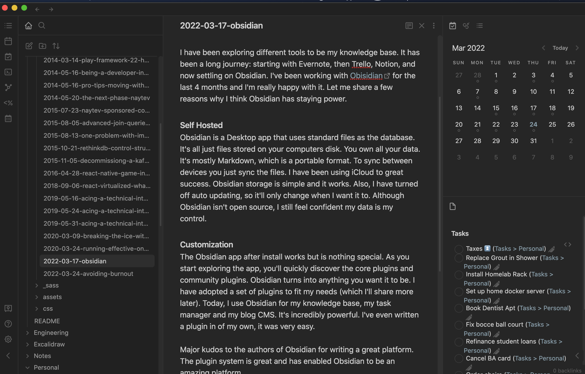

For the past 10 years, I have been experimenting with different tools to be my knowledge base. It has been a long journey: starting with Word, then Evernote, Trello, Notion, and now I have settled on Obsidian. I've been working with [Obisidian](https://obsidian.md/) for the last 4 months and I'm really happy with it. I'm going to share a few reasons why I think Obsidian has staying power.

## Self Hosted
Obsidian is a Desktop/Mobile app that uses standard files as the database. It's all just files stored on your devices disk. You own all your data. The files are Markdown, which can be used everywhere. To sync between devices you just sync the files. I have been using iCloud to great success. Obsidian storage is simple and it works. Also, I have turned off app auto updating, so it'll only change when I want it to. Although Obsidian isn't open source, I still feel confident my data is my control.

## Customization
The Obsidian app after install works but is nothing special. As you start exploring the app, you'll quickly discover the core plugins and community plugins. Obsidian can turn into anything you want it to be. I have adopted a set of plugins to fit my needs (which I'll share more later). Today, I use Obsidian for my knowledge base, my task manager and my blog CMS. It's incredibly powerful. I've even written a plugin in of my own, it was very easy.

## Graph View
The Graph View is one of the features that everyone shows off. Especially on [reddit](https://www.reddit.com/r/ObsidianMD/) , people love to share their massive graph connecting all their content. For me, the general graph view has been useless. What I do use is the "Local Graph". From a document, I can see the related links and hashtags that reference this file or are being referenced from the document. It's a great tool to navigate related content. 

Major kudos to the authors of Obsidian for writing a great platform. The plugin system is great and has enabled Obsidian to be an amazing platform. Thank you for the great app and excited for it to grow with me.

