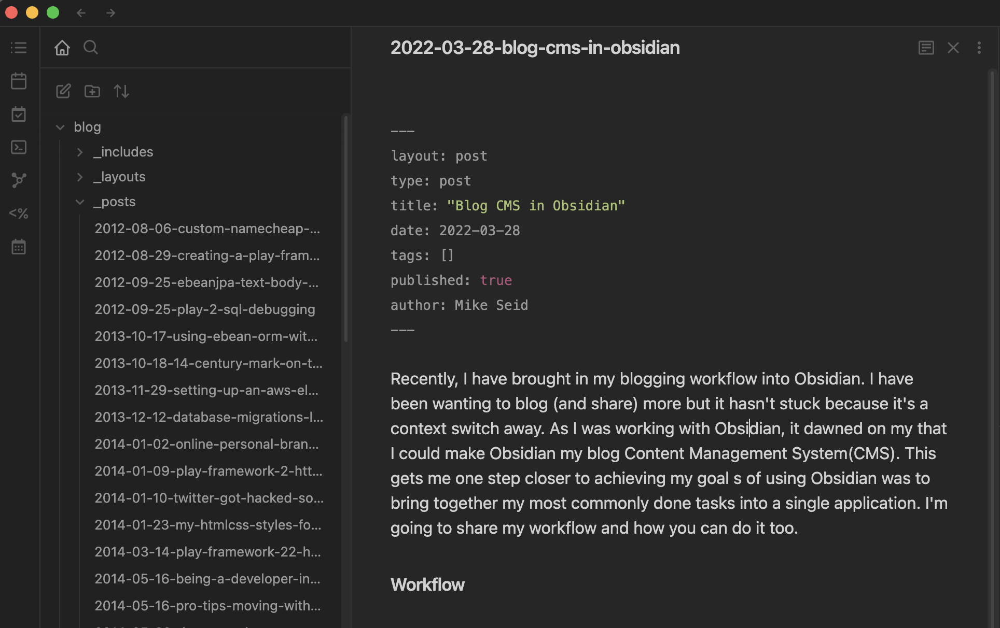
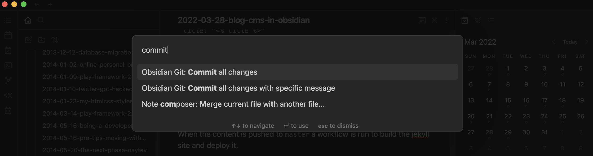

Recently I have brought my blogging workflow into Obsidian. I want to blog (and share) more but I haven't been able to build a habit. Having my blog be a separate app/editor makes writing a post a large context switch away. As I was working with Obsidian, it dawned on my that I could make Obsidian my blog Content Management System(CMS). This gets me one step closer to achieving my goal of using Obsidian to bring together my most common tasks into a single application. I'm going to share my workflow and how you can do it too.

Technologies used:
- [Jekyll](https://jekyllrb.com/)
- [Github Pages](https://pages.github.com/)
- [obsidian-git](https://github.com/denolehov/obsidian-git)
- [Templater](https://github.com/SilentVoid13/Templater)

## Workflow



The blog is in the folder `blog` within my vault. The blog is the checked out repository. Since the posts are regular markdown files, they can be created and written like any other Obsidian note. 

To create a post, I make a new note and insert my blog post Templater template. This template will prompt me for a blog title, then update the title and insert the frontmatter. 

```md
<%* 
title = await tp.system.prompt("Post Name?");
await tp.file.rename(tp.date.now()+"-"+title.toLowerCase().replaceAll(" ", "-"));
%>
---
layout: post
type: post
title: "<% title %>"
date: <% tp.date.now() %>
tags: []
published: true
author: Mike Seid
---

```




Once I've finished writing, I use `obsidian-git` to commit all the files and then push to my master branch. From there Github Pages does the rest. When the content is pushed to `master` a workflow is run to build the jekyll site and deploy it.  

## How to set up

To set up yourself, follow these steps:

1. Install the plugins `Templater` and `obsidian-git`
2. Check out your blog respiratory to the root of your Vault.
3. Turn on both plugins.
4. Set up `obsidian-git` Git Repository Path setting to the name of your repository.
5. Copy the template content above to the template folder.
6. That is it. Blog away

## Limitations

There are few limitations with with this setup to be aware of. 

1. You can only have one git repo with the `obisidian-git` plugin. If you are already using the plugin to sync your repo, then you cannot use this pattern.
2. You must use my [obisdian-git](https://github.com/mbseid/obsidian-git/tree/basePath) branch for now. The [PR to the core repository](https://github.com/denolehov/obsidian-git/pull/209) is still pending to be merged.
3. Images aren't visible in the preview. This is because the images path is to the assets folder and not to the vault root. Seems fixable but unsure as of now. 


---

I wanted to share a big hat tip to [github/Vinzent03](https://github.com/Vinzent03) for being a great maintainer and reviewer of the `obsidian-git` plugin. 
